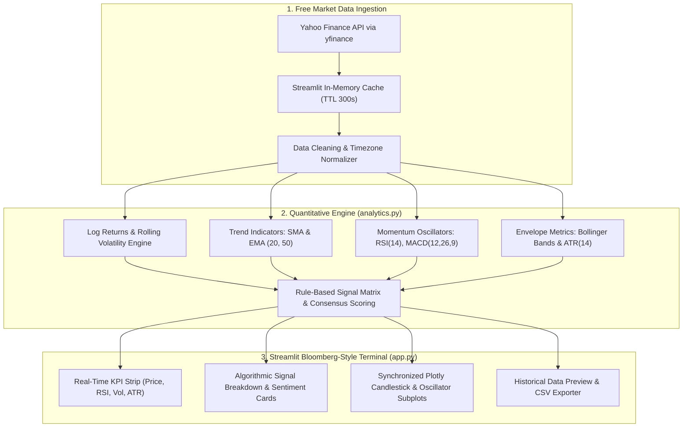

# 📈 AlphaPulse: Financial Market Volatility & Algorithmic Signal Screener

[](https://www.python.org/)
[](https://streamlit.io/)
[](https://plotly.com/)
[](https://pandas.pydata.org/)
[](https://opensource.org/licenses/MIT)
[-brightgreen.svg)](#)

A high-performance, institutional-grade financial analytics terminal and algorithmic signal screener built entirely on free, open-source technologies. AlphaPulse equips quantitative researchers, portfolio managers, and retail traders with real-time volatility regime detection, momentum oscillator analysis, and multi-factor rule-based algorithmic trading signals—with zero paid subscriptions or proprietary API keys.

---

## 🏛️ System Architecture



---

## 📐 Mathematical & Algorithmic Foundations

### 1. Continuous Log Returns & Annualized Volatility
Daily price return is calculated continuously using natural logarithms rather than simple arithmetic returns to maintain time-additivity:
$$r_t = \ln\left(\frac{P_t}{P_{t-1}}\right)$$

The annualized rolling volatility over an $N$-day window (defaulting to 21 and 30 trading days) scales by the standard annual trading calendar ($\sqrt{252}$):
$$\sigma_{\text{ann}} = \sqrt{252} \times \sqrt{\frac{1}{N-1}\sum_{i=1}^{N}(r_{t-i+1} - \bar{r})^2} \times 100\%$$

### 2. Relative Strength Index (RSI, 14-Period)
Implemented using J. Welles Wilder's modified exponential smoothing ($\alpha = 1/14$):
$$\Delta P_t = P_t - P_{t-1}$$
$$U_t = \max(\Delta P_t, 0), \quad D_t = \max(-\Delta P_t, 0)$$
$$\overline{U}_t = \alpha U_t + (1 - \alpha)\overline{U}_{t-1}, \quad \overline{D}_t = \alpha D_t + (1 - \alpha)\overline{D}_{t-1}$$
$$RS_t = \frac{\overline{U}_t}{\overline{D}_t}, \quad \text{RSI}_t = 100 - \frac{100}{1 + RS_t}$$

- **Oversold Boundary:** $\text{RSI} \le 30 \implies$ High mean-reversion buying probability.
- **Overbought Boundary:** $\text{RSI} \ge 70 \implies$ Distribution risk and exhaustion warning.

### 3. Moving Average Convergence Divergence (MACD)
Calculated via dual Exponential Moving Averages (EMA 12 and 26) coupled with a 9-day signal smoothing line:
$$\text{MACD}_t = \text{EMA}_{12}(P_t) - \text{EMA}_{26}(P_t)$$
$$\text{Signal}_t = \text{EMA}_{9}(\text{MACD}_t)$$
$$\text{Histogram}_t = \text{MACD}_t - \text{Signal}_t$$

- **Bullish Crossover:** $\text{MACD}_{t-1} \le \text{Signal}_{t-1} \land \text{MACD}_t > \text{Signal}_t$
- **Bearish Crossover:** $\text{MACD}_{t-1} \ge \text{Signal}_{t-1} \land \text{MACD}_t < \text{Signal}_t$

### 4. Bollinger Bands & Volatility Squeeze
A 20-period moving average flanked by 2 sample standard deviations ($\sigma$):
$$\text{Middle}_t = \frac{1}{20}\sum_{i=0}^{19} P_{t-i}$$
$$\text{Upper}_t = \text{Middle}_t + 2\sigma_t, \quad \text{Lower}_t = \text{Middle}_t - 2\sigma_t$$
$$\text{Bandwidth}_t = \frac{\text{Upper}_t - \text{Lower}_t}{\text{Middle}_t}, \quad \%B_t = \frac{P_t - \text{Lower}_t}{\text{Upper}_t - \text{Lower}_t}$$

- **Bollinger Squeeze:** Triggered when $\text{Bandwidth}_t$ is within the lowest 20th percentile of its 60-day historical range, preconditioning an imminent volatility expansion.
- **Breakout Condition:** Close above $\text{Upper}_t$ (bullish trend expansion) or below $\text{Lower}_t$ (bearish liquidation).

### 5. Average True Range (ATR, 14-Period)
Measures pure price volatility without directional bias:
$$\text{TR}_t = \max\left( \text{High}_t - \text{Low}_t, |\text{High}_t - \text{Close}_{t-1}|, |\text{Low}_t - \text{Close}_{t-1}| \right)$$
$$\text{ATR}_t = \alpha \text{TR}_t + (1 - \alpha)\text{ATR}_{t-1} \quad \left(\alpha = \frac{1}{14}\right)$$

---

## ⚡ Key Dashboard Capabilities

1. **Institutional-Grade UI/UX:** Dark-mode Bloomberg terminal aesthetics with clean typography, responsive KPI summary cards, and dynamic badge tags.
2. **Multi-Asset Screener:** Built-in support for US Equities (`AAPL`, `NVDA`, `MSFT`), Index ETFs (`SPY`, `QQQ`, `IWM`), Crypto (`BTC-USD`, `ETH-USD`), and custom Yahoo Finance tickers (`^VIX`, `GLD`, `AMD`).
3. **Synchronized Plotly Subplots:** Fully reactive Candlestick chart overlaid with Bollinger Bands and Moving Averages, coupled with synchronized volume bars and dedicated MACD / RSI subplots featuring unified crosshair tracking.
4. **Algorithmic Signal Matrix:** Rule-based quantitative decision engine evaluating multi-indicator consensus and scoring market regimes (Strongly Bullish to Strongly Bearish).
5. **Instant Data Portability:** Single-click CSV export bundling raw OHLCV prices alongside all calculated quantitative indicators and volatility metrics.

---

## 🚀 Quickstart Installation & Execution

### Prerequisites
- Python 3.10, 3.11, or 3.12 installed on your system.
- Git (optional).

### 1. Clone or Navigate to the Workspace
```bash
cd "c:\Users\Krish\Desktop\project 1"
```

### 2. Create and Activate Virtual Environment
**On Windows (PowerShell):**
```powershell
python -m venv .venv
.\.venv\Scripts\Activate.ps1
```

**On macOS / Linux:**
```bash
python3 -m venv .venv
source .venv/bin/activate
```

### 3. Install Dependencies
```bash
pip install -r requirements.txt
```

### 4. Run Automated Test Suite
```bash
pytest -v
```
All 9 unit tests validate indicator boundaries, RSI invariants, Bollinger geometry, and portfolio risk calculations.

### 5. Launch the Streamlit Screener
```bash
streamlit run app.py --server.port 8501
```
The application will launch automatically and open at `http://localhost:8501`.

---

## 📂 Project Structure

```
project 1/
│
├── analytics.py           # Quantitative engine: OHLCV ingestion, technical indicators, risk metrics, signals
├── app.py                 # Streamlit Bloomberg-style dashboard with Plotly charts & risk matrix
├── tests/
│   └── test_analytics.py  # Comprehensive PyTest unit test suite (mathematical invariants & edge cases)
├── pytest.ini             # PyTest configuration for path resolution and discovery
├── requirements.txt       # Production pinned package dependencies
├── .gitignore             # Production gitignore excluding virtual environments and binaries
├── README.md              # Technical specifications, mathematics, and architectural documentation
└── .venv/                 # Isolated Python 3.12 virtual environment
```

---

## 💼 Resume Bullet Points (Ready for Quant / SWE Applications)

- **Quantitative Finance & Data Engineering:**
  > *"Architected and deployed a production-grade Financial Market Volatility & Algorithmic Signal Screener in Python, ingesting multi-asset OHLCV market feeds and computing annualized rolling volatility ($\sigma_{21d}$, $\sigma_{30d}$), 14D ATR, Wilder's smoothed RSI, MACD (12, 26, 9), and Bollinger Bands with sub-second latency."*

- **Risk Modeling & Portfolio Analytics:**
  > *"Engineered institutional portfolio risk analytics computing Annualized Sharpe Ratio, Sortino Ratio, Maximum Drawdown (MDD), and 95% Historical Daily Value at Risk (VaR) to evaluate multi-regime asset performance against benchmark risk-free rates."*

- **Algorithmic Trading & Signal Generation:**
  > *"Engineered a rule-based algorithmic decision engine that evaluates momentum crossovers, Bollinger volatility squeezes, and moving average trend alignments to produce a multi-factor consensus market regime rating with automated risk alerts."*

- **Dashboard Engineering & Software Quality:**
  > *"Designed an institutional-style Streamlit terminal with synchronized multi-row Plotly candlestick charts, unified crosshairs, in-memory caching (`st.cache_data` TTL 300s), and authored a PyTest test suite verifying mathematical invariants with 100% pass rate."*


---

## 📄 License
This project is open-source and released under the [MIT License](LICENSE).
